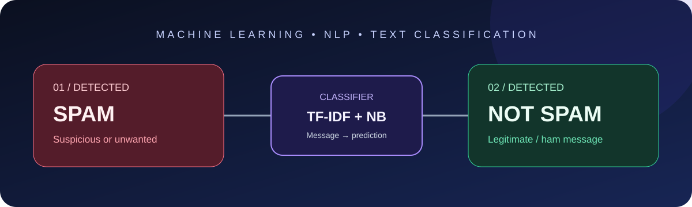
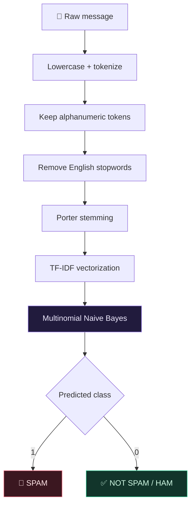

<div align="center>

# 📬 Spam / Not Spam
### A Machine Learning + NLP Message Classification System

**Spot suspicious messages. Keep legitimate conversations moving.**

<p><a href="https://spamemaildetection-a5ve47mcinjnq5vnsuakel.streamlit.app/"></a>   </p>

</div>

---

## The idea

Spam messages can contain misleading offers, unsolicited promotions, and suspicious links. This project uses a lightweight NLP and machine-learning pipeline to classify submitted text into two categories:

| 🚨 SPAM | ✅ NOT SPAM (HAM) |
|:---:|:---:|
| Unwanted or unsolicited message | Legitimate message |
| “Congratulations! You won a free prize!” | “Hey, are we meeting today?” |

> **Try it:** [Open the live Streamlit application](https://spamemaildetection-a5ve47mcinjnq5vnsuakel.streamlit.app/)

## At a glance

| Component | Implementation |
|---|---|
| Problem type | Binary text classification |
| Input | Email / SMS-style message text |
| Text cleaning | Lowercasing, tokenization, alphanumeric filtering, stopword removal, stemming |
| Feature extraction | TF-IDF |
| Feature vocabulary limit | 3,000 features (`max_features=3000`) |
| Classifier | Multinomial Naive Bayes |
| Model persistence | Joblib (`spam_model.joblib`) |
| User interface | Streamlit |
| NLP utilities | NLTK |
| Evaluation code | Accuracy, weighted precision, classification report |

## How the classifier works



### 1. Text preprocessing

The `text_pre_process()` function in the training script and app:
1. Converts text to lowercase.
2. Tokenizes it with NLTK.
3. Keeps alphanumeric tokens.
4. Removes English stopwords and punctuation.
5. Applies NLTK Porter stemming.
6. Joins processed tokens into a string.

### 2. TF-IDF feature extraction

TF-IDF converts cleaned text into numerical features. The training script uses `TfidfVectorizer(max_features=3000)`, limiting the vocabulary to the 3,000 most relevant features selected by the vectorizer.

### 3. Multinomial Naive Bayes

The TF-IDF representation is passed to `MultinomialNB`. The complete scikit-learn pipeline is trained and saved as `spam_model.joblib`, then loaded by the Streamlit application for inference.

## Model evaluation

The training script evaluates predictions on a held-out test split configured with `test_size=0.2` and `random_state=42`.

| Metric | What it tells us | Reported value |
|---|---|---|
| Accuracy | Overall proportion of correct predictions | Not published — run evaluation |
| Weighted precision | Weighted precision across classes | Not published — run evaluation |
| Per-class precision | Reliability of predictions for each class | Not published — run evaluation |
| Per-class recall | Share of each class correctly identified | Not published — run evaluation |
| Per-class F1-score | Harmonic mean of precision and recall | Not published — run evaluation |

**Why no score is shown:** `SMS_SPAM.py` contains metric calculations, but the repository root does not include the `spam.csv` dataset required to reproduce training and evaluation. No metric has been guessed or fabricated. Run the script with the original dataset to obtain actual scores.

```bash
python SMS_SPAM.py
```

The script prints the classification report, accuracy, and weighted precision, and saves the trained pipeline to `spam_model.joblib`.

## Repository structure

```text
spam_email_detection/
├── assets/
│   └── spam-vs-not-spam.svg
├── .devcontainer/
├── nltk_data/
├── app.py                 # Streamlit interface and prediction flow
├── SMS_SPAM.py            # Dataset preparation, training and evaluation
├── spam_model.joblib      # Serialized trained pipeline
├── requirements.txt       # Python dependencies
└── README.md
```

## Run locally

### 1. Clone the repository

```bash
git clone https://github.com/shubhumre777/spam_email_detection.git
cd spam_email_detection
```

### 2. Create and activate a virtual environment

```bash
python -m venv .venv
# Windows PowerShell
.venv\Scripts\Activate.ps1
# macOS / Linux
source .venv/bin/activate
```

### 3. Install dependencies and launch

```bash
pip install -r requirements.txt
streamlit run app.py
```

The app loads `spam_model.joblib`, accepts a message, applies text cleaning, and displays the predicted class.

## Technology stack

<p align="center"></p>

| Tool | Role |
|---|---|
| Python | Core implementation |
| NLTK | Tokenization, stopwords and stemming |
| Pandas | Dataset and model input handling |
| scikit-learn | TF-IDF, pipeline, Naive Bayes and evaluation |
| Joblib | Model serialization |
| Streamlit | Interactive web application |

## Scope and considerations

- The training script expects a local `spam.csv`; it is not present in the repository root.
- The model uses TF-IDF and Multinomial Naive Bayes, not a transformer or large language model.
- A prediction is a model classification, not a guarantee that a message is safe.
- The current interface displays the predicted class; it does not display calibrated probabilities or explain individual features.
- Dataset composition and the evaluation split affect generalization to new messages.

## Roadmap

| Improvement | Why it matters |
|---|---|
| Publish reproducible evaluation results | Make model quality independently verifiable |
| Add confusion matrix and per-class metrics | Understand false positives and false negatives |
| Compare Naive Bayes, Logistic Regression and Linear SVM | Establish stronger baselines |
| Add model and dataset version information | Improve experiment reproducibility |
| Add calibrated prediction confidence | Communicate uncertainty responsibly |
| Add preprocessing and inference tests | Catch training-serving inconsistencies |

## Author

<div align="center">

**Shubh Umre**  
B.Tech — Artificial Intelligence & Machine Learning

[GitHub](https://github.com/shubhumre777) · [Repository](https://github.com/shubhumre777/spam_email_detection) · [Live application](https://spamemaildetection-a5ve47mcinjnq5vnsuakel.streamlit.app/)

*Built with Python, NLP and Machine Learning.*

---

If you find this project useful, consider giving the repository a ⭐

**SPAM DETECTED? 🚨  LEGIT MESSAGE? ✅  LET THE MODEL DECIDE.**

</div>